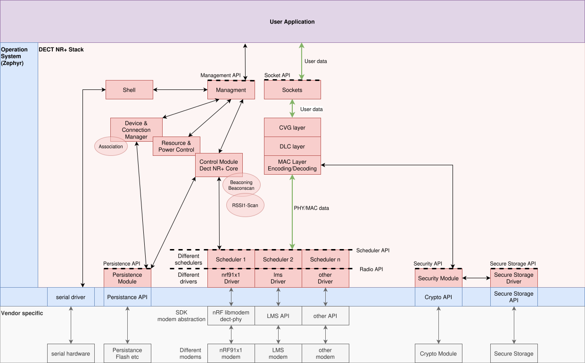

..  architecture-overview:

Architecture
============

.. note::
    This document acts as an starting point to document DECT NR+ Stack. 
    It is work in progress and first collects some ideas.

    Following proposal is intended for integration into Zephyr net-stack architecture `Network Stack Architecture
    <https://github.com/zephyrproject-rtos/zephyr/blob/v4.2-branch/doc/connectivity/networking/net-stack-architecture.rst>`_ 
    but may be also used in an Zephyr independent environment.

Modules
-------

*   Driver(s)

    *   For each supported modem there should be a driver which abstracts the vendor specific implementation and maps it to the `DECT NR+ Driver API`.
    *   Currently only nRF91x1 supporting nRF9151, nRF9161, nRF9131 (all have same core nRF9120).
    *   With Zephyr it is theoretically possible to have multiple drivers at the same time but the regular case is to select just one driver at build-time.
    *   It provides features selectable at build time.
    *   Other features are configurable at run-time and per operation.
    *   It provides asynchronous/synchronous handling of RX, TX and RSSI1 operations.
    *   It optionally may provide synchronisation features.
*   Scheduler

    *   Scheduler module does handle the timed interactions with the modem/driver via `DECT NR+ Driver API`. 
    *   It uses resources provided by the `Resource & Power manager`.
    *   It schedules beacons (FT, FT&PT) and/or beacon-scan operations (PT, FT&PT).
    *   It optionally may provides synchronization events up to the stack and via GPO
    *   It synchronizes to received beacons and/or optionally via  GPIO
    *   It schedules RX, TX and RSSI1 operations on resources.
    *   It selects the working channel or can handle multiple channels assignable per resource.
    *   There may be multiple implementations for different scheduling strategies.
    *   One implementation selected at build time.
*   Resource Manager & Power Control

    *   (May be part of the scheduler?)
    *   (Power Control may be a separte module?)
    *   Holds and manages radio resources and related tx-powers.
    *   There may be multiple implementations / algorithms for different management strategies.
    *   Resource Manager

        *   Should manage specific resource(s) for beaconing and management channel.
        *   Should have predefined resource schemas (ideally officially specified later on) which are selectable at build/run-time.
        *   Should have a management interface to manage user resources at run-time.
    *   Power Control - controls the tx-power of tx-resources 

        *   on per-remote-device basis
        *   considering rssi2, snr and tx-power of remote device
        *   considering current BLER and currently selected mcr
*   MAC layer encoding/decoding

    *   Module which does the encoding of out-going MAC layer PDUs which should be transmitted via `DECT NR+ Driver API` / `DECT NR+ Scheduler` and decoding of in-coming MAC layer PDUs received via `DECT NR+ Driver API` / `DECT NR+ Scheduler`.
    *   All supported SDUs should have encoding and decoding functionality.
*   DLC layer

    *   Module which does the encoding of out-going DLC layer PDUs which should be handed to MAC layer encoding and decoding of in-coming DLC layer PDUs handed over from MAC layer decoding.
    *   Should handle different service types

        *   Transparent service
        *   Segmentation/Assembly
        *   ARQ
        *   Routing
*   CVG layer

    *   Module which does the encoding of out-going CVG layer PDUs which should be handed to DLC layer encoding and decoding of in-coming CVG layer PDUs handed over from DLC layer decoding.
    *   Should handle different service types
    *   Endpoint multiplexing
    *   Interacts with `Configuration Data Distribution` (CDD)
*   Control Module / DECT NR+ Core

    *   Core module which should manage the state(s) and coordinate services of the stack.
    *   Coordination of control messages / incoming control messages.
    *   Multiple implementations possible for FT/PT/FT&PT.
*   Device & Connection Manager

    *   Holds own device parameters (as network-id, long ID, short ID).
    *   Holds device parameters and state of remote devices.
    *   Association management
*   Secure Storage

    *   Securely stores/persists security redentials as keys etc
*   Persistence Module

    *   The common part of the persistance implementation.
    *   Should map vendor/hardware specific persitance up to the Persistence API.
*   Managment

    *   The module which connects the `Managment API` with different blocks of the stack mainly the Control Module.
*   Shell

    *   Module providing some sort of shell (via uart etc) to the remote user.
    *   It mainly uses the `Managment module (dectnrp_mgmt)` to run commands etc on the stack.
*   Sockets

    *   A common POSIX conform socket implementation to allow the user/application to communicate with the application.

API Reference
-------------

DECT NR+ API Overview
^^^^^^^^^^^^^^^^^^^^^

*   :doc:`dectnrp-driver-api`

    *   The common interface between `DECT NR+ Scheduler` and `DECT NR+ Driver`.
    *   This interface dispatches so called Driver Operations (RX, TX, RSSI1) between scheduler and driver.
*   :doc:`dectnrp-sdlr-api`

    *   A common interface for different scheduler implementations.
    *   Provides an interface for the Core Module to manage the scheduler and callbacks where scheduler can notify the core.
*   Persistence API

    *   A common interface to persist and read non-volatile parameters of the stack like network-id, long device id etc.
*   Secure Storage API

    *   A common interface to manage and access security items like crypto keys.
*   Security API

    *   A common interface to handle encryption/authentication and decryption/verification of secured DECT NR+ messages.
*   Managment API

    *   A common interface between DECT NR+ stack and application by which the application can manage the stack, get information about state and behaviour.
*   Socket API

    *   A common POSIX socket interface to allow the user/application to provide data towards the stack (tx) and receive data from remote devices (rx).    

.. toctree::
    :hidden:
    :maxdepth: 2

    dectnrp-driver-api
    dectnrp-sdlr-api