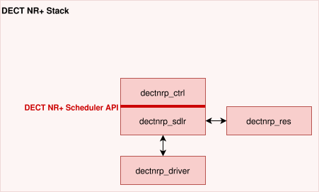

..  dectnrp-sdlr-api:

DECT NR + Scheduler API
***********************

.. note::
  This document acts as an starting point to document the DECT NR+ Scheduler API. 
  It is work in progress and first collects some ideas.
  The terms radio and modem in this context are used synonymously.

  Following proposal is intended for integration into Zephyr net-stack architecture `Network Stack Architecture
  <https://github.com/zephyrproject-rtos/zephyr/blob/v4.2-branch/doc/connectivity/networking/net-stack-architecture.rst>`_ 
  but may be also used in an Zephyr independent OS environment.

Overview
========

The DECT NR+ Scheduler API is a common interface between DECT NR+ Stack (in particular the Control Module dectnrp_ctrl) and the Scheduler (dectnrp_sdlr).

This interface

*   provides a interface to manage the scheduler for example to manage its state and behaviour.
*   provides a interface to append fully encoded messages to working queues which needs to be scheduled to radio resources.
*   dispatches received un-decoded messages and RSSI1 results up to the stack (MAC/control).
*   notifies events from scheduler up to the stack.

DECT NR + Scheduler API
=======================

In the header file `dectnrp_sdlr_api.h <include/dectnrp_sdlr_api.h>`_ a first 
implementation for demonstration purposes is provided. 
