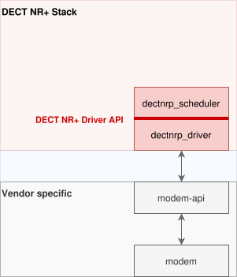

..  dectnrp-driver-api:

=======
Preface
=======

This document acts as an starting point to document the DECT NR+ Driver API. 
It is work in progress and first collects some ideas.
The terms radio and modem in this context are used synonymously.

Following proposal is intended for integration into Zephyr net-stack architecture `Network Stack Architecture
<https://github.com/zephyrproject-rtos/zephyr/blob/v4.2-branch/doc/connectivity/networking/net-stack-architecture.rst>`_ 
but may be also used in an Zephyr independent OS environment.

========
Overview
========

The DECT NR+ Driver API is a common interface between DECT NR+ Stack (in particular the Scheduler dectnrp_sdlr) and the Driver (dectnrp_driver).

This interface

*   provides a interface to query capabilities and parameters from driver/radio.
*   provides a interface to configure the driver/radio.
*   dispatches so called Driver Operations (RX, TX, RSSI1) between scheduler and driver.
*   notifies events from driver up to the stack.

====================
DECT NR + Driver API
====================

This proposal is based on the public driver API of IEEE 802.15.4 implemented in Zephyr 
`Public IEEE 802.15.4 Driver API
<https://github.com/zephyrproject-rtos/zephyr/blob/v4.2-branch/include/zephyr/net/ieee802154_radio.h>`_. 
It has been stripped of all IEEE 802.15.4 specific stuff and DECT NR+ specific (scheduling) features has been added.

In the header file `dectnrp_driver_api.h <include/dectnrp_driver_api.h>`_ a first 
implementation for demonstration purposes is provided. 

The scheduling API may come in two flavours which can be activated at build time:

* **Asynchronous mode:** Asynchronous operations are scheduled and do return immediately. The finished operation is notified later via event callback which may return success or an error code. This mode is the 'regular' case as multiple operations can be pending at the same time.
  The operation itself (dectnrp_driver_op) holds all parameters needed to schedule that operation and at the same time its address acts as a handle to that very operation.
* **Blocking mode:** Synchronous operations are scheduled immediately and are blocking until the operation has been finished or an error occurred. This mode can only handle one operation at the same time and may be used for more simple use-cases as sniffing or testing. 
  For blocking operations the channel gets set with a dedicated function.

 

